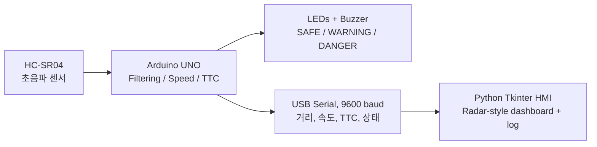

# THREAT-TRACK · Tactical Proximity Defense Console
### 초음파 기반 전술형 근접 위협 감지·관제 시스템

  

> **EN** A real Arduino + ultrasonic prototype that converts range measurements into approach speed, time-to-contact (TTC), visual and audible warnings, and a Python operator console.  
> **KO** 초음파 거리 측정값을 접근 속도·예상 접촉 시간(TTC)·LED/부저 경보·Python 관제 인터페이스로 연결하는 임베디드 프로젝트입니다.

**Project objective / 프로젝트 목적**  
Turn a single-axis proximity sensor into an interpretable, real-time warning and human–machine interface (HMI) prototype. / 단일축 근접 센서를 직관적인 위험 경고 및 인간-기계 인터페이스(HMI)로 확장합니다.

> This is an educational HC-SR04 **ultrasonic demonstration, not radio-frequency radar**. 2D/3D positioning and real military/security deployment are unsupported. / 군용 전파 레이더가 아닌 교육용 **초음파 근접 감지 프로토타입**입니다.

## Hardware evidence & technical visuals / 실제 제작 기록과 기술 도면

The project uses **user-captured** hardware and Arduino IDE photographs, reproducible **Matplotlib** figures, and technical wiring **CAD** rather than AI-generated illustration. / 실제 사용자 촬영 사진·Arduino IDE 화면·Matplotlib 그래프·CAD 배선도만 사용합니다.

> Asset upload in progress; the corresponding visuals will be linked directly from this README once committed. / 실제 이미지 파일을 업로드한 뒤 이 README에 바로 표시되도록 연결합니다.

## System design / 작동 구조



| Component / 부품 | Arduino pin | Function / 기능 |
|---|---|---|
| HC-SR04 VCC/GND | 5V / GND | Sensor supply / 센서 전원 |
| HC-SR04 TRIG | D2 | Trigger / 초음파 발사 |
| HC-SR04 ECHO | D3 | Echo / 반사파 수신 |
| Red LED + resistor | D4 | DANGER / 위험 |
| Yellow LED + resistor | D5 | WARNING / 주의 |
| Green LED + resistor | D6 | SAFE / 안전 |
| Low-current piezo buzzer | D7 | Audible alarm / 경고음 |

Each LED has **its own series resistor** and all devices share GND. For the demonstrated buzzer breadboard placement, positive is e27 (D7 through a27) and negative e30 (GND through a30). / 각 LED에 직렬 저항 하나씩 사용하고 접지는 공통으로 연결합니다. 부저 예시: e27(+)→a27→D7, e30(-)→a30→GND.

## Threat model / 위험 경보 판정

```text
distance_cm = echo_duration_us × 0.0343 ÷ 2
filtered_distance = 0.4 × new_distance + 0.6 × previous_distance
approach_speed_cm_s = (previous_distance − current_distance) ÷ elapsed_seconds
TTC_seconds = filtered_distance ÷ filtered_approach_speed (if speed > 10 cm/s)
```

| State | Decision threshold / 임계 조건 | Alert / 경보 |
|---|---|---|
| SAFE | d > 70 cm and no TTC warning | Green LED; silent / 초록·무음 |
| WARNING | d ≤ 70 cm or 0 < TTC ≤ 3 s, except DANGER | Yellow LED; slow beep / 노랑·느린 경고 |
| DANGER | d ≤ 30 cm or 0 < TTC ≤ 1.5 s | Red LED; fast beep / 빨강·빠른 경고 |
| NO_SIGNAL | Invalid echo / 측정 무효 | LEDs off, silent / 경보 끔 |

These numbers are **prototype policy thresholds**, not validated collision probabilities. / 위 수치는 실험용 경보 규칙이며 실증된 위험 확률은 아닙니다.

## Getting started / 실행 방법

1. Open `arduino/ThreatTrack_V5/ThreatTrack_V5.ino` and upload it from Arduino IDE with the correct board and COM port. / Arduino IDE에서 UNO와 포트를 선택하고 펌웨어 업로드.
2. Install dependencies: `py -m pip install -r python/requirements.txt`.
3. **Close the Arduino Serial Monitor** to release the COM port. / 포트 충돌 방지를 위해 시리얼 모니터를 닫으세요.
4. Launch: `py python/threat_track_dashboard.py --port COM5` (adjust COM port as needed). / 실제 포트 번호에 맞춰 실행.
5. Offline UI demo (simulated values): `py python/threat_track_dashboard.py --demo`.

Serial packets / 시리얼 형식: `distance_cm,approach_cm_s,ttc_seconds,status` (e.g. `23.4,42.8,0.55,DANGER`). This sample is **illustrative**, not a captured measurement. / 예시는 설명용 값입니다.

## What has been verified / 검증 현황

| Milestone / 단계 | Evidence / 확인 |
|---|---|
| HC-SR04 distance readings | Actual Arduino Serial Monitor photo / 실제 촬영 화면 |
| Three LED indicators | Builder-reported working / 제작자 동작 확인 |
| Buzzer warning | Builder-reported working / 제작자 동작 확인 |
| Tkinter desktop dashboard | Window opens / GUI 실행 |
| V5 live serial refresh | **Pending recheck** after COM5 port conflict / 포트 충돌 해결 후 재확인 필요 |
| Radar-style sweep | **Visual effect only**; no angle measurement / 각도 센싱 기능 없음 |

## Engineering rationale & limitations / 설계 타당성과 한계

**EN** Signal processing, classification, actuation, and visualization are separated so future evaluation can measure range error, alert latency, and invalid-reading rate. A single HC-SR04 reports range only: it cannot recognize identity, heading or multiple objects, and TTC assumes constant relative speed. The project is a working educational prototype, **not a certified safety or military system**.

**KO** 거리 측정·상태 판단·경보·관제 인터페이스를 분리하여 추후 거리 오차, 경고 지연, 무효 신호 비율을 측정할 수 있도록 설계했습니다. HC-SR04 한 개로 물체의 신원, 방위각, 다중 표적은 탐지할 수 없으며, TTC에는 상대속도가 일정하다는 가정이 있습니다. 안전 인증된 장치가 아닌 교육용 프로토타입입니다.

**Author / 제작:** Doyun Shin · 신도윤 — Gachon University, Industrial Engineering / 가천대학교 산업공학과.
