# THREAT-TRACK · Tactical Proximity Defense Console
### 초음파 기반 전술형 근접 위협 감지·관제 시스템

[](arduino/ThreatTrack_V5/ThreatTrack_V5.ino)
[](python/threat_track_dashboard.py)
[](docs/)
[](#project-status--프로젝트-진행-상태)
[](tests/test_telemetry.py)

**한국어** · 아두이노와 초음파 센서로 물체까지의 거리를 측정하고, 접근 속도와 예상 접촉 시간(TTC)을 계산해 위험 단계별로 경고하도록 만들었다. 3색 LED와 부저를 연결했고, Python으로 측정값을 볼 수 있는 관제 화면도 제작했다.

**English** · I built an Arduino-based proximity monitor that combines ultrasonic distance readings with estimated approach speed and time-to-contact (TTC). Three LEDs and a buzzer indicate the alert level, and a Python dashboard displays the measurements.

> **참고 / Note** · HC-SR04를 사용하는 교육용 초음파 근접 감지 프로젝트다. 전파 레이더나 안전 인증 장비는 아니며, 화면에 보이는 회전 스윕은 시각적 효과다. / This is an educational ultrasonic prototype, not an RF radar or certified safety device. The animated sweep is decorative.

## Build photos & interface / 제작 사진과 인터페이스

| **Real prototype photo / 실제 제작 사진** | **CAD wiring diagram / CAD 배선도** |
|:---:|:---:|
| 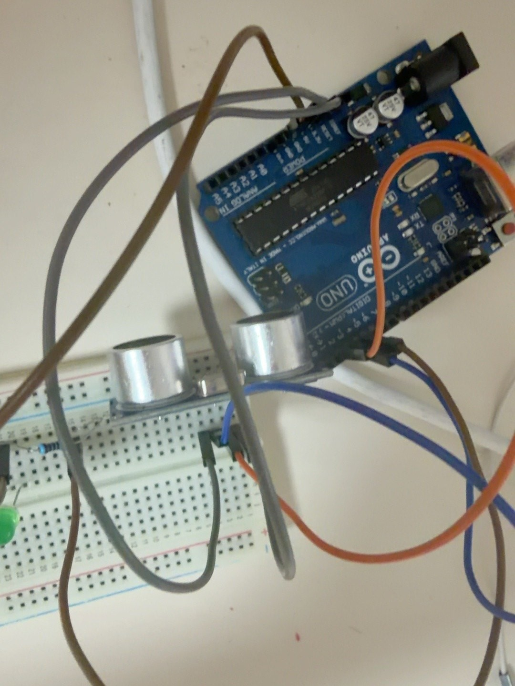 | 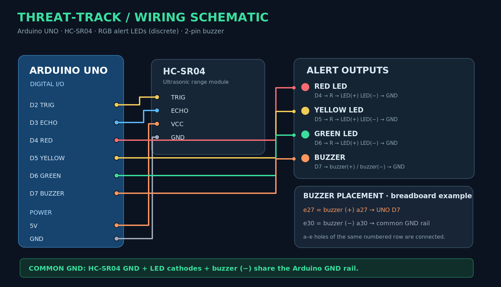 |
| **Recorded hardware photo** — Arduino UNO, HC-SR04, breadboard / **실제 촬영 사진** — 아두이노와 센서 | **Technical schematic** — schematic-level connections, not a measured PCB layout / **기술 배선도** — 핀 배치 기반 설계도 |

| **Actual serial output / 실제 시리얼 출력** | **Tactical dashboard / 전술형 관제 화면** |
|:---:|:---:|
| 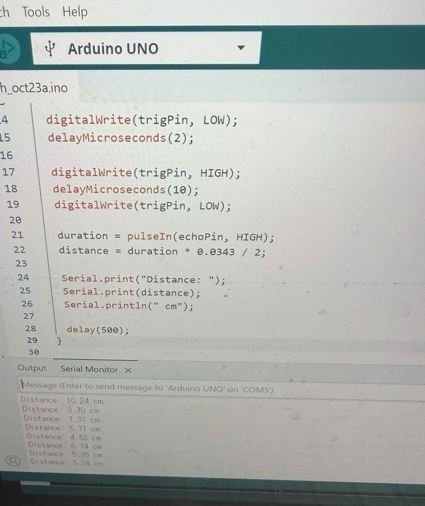 | 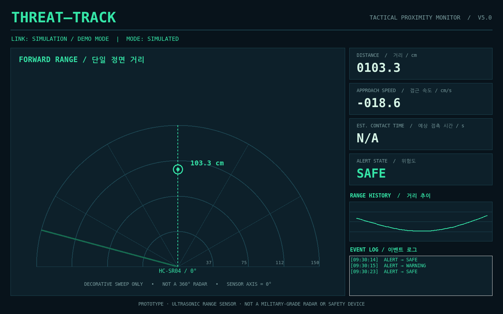 |
| **Actual screenshot** — ultrasonic range measurements / **실제 캡처** — 거리 측정값 출력 | **Actual screenshot of the Python GUI in `--demo` mode (simulated values)** — *not* live telemetry / **실제로 실행한 Python GUI의 데모 모드 캡처** — 가상 데이터, 실측 아님 |

**Design files / 설계 파일:** [Editable AutoCAD-compatible DXF](docs/cad/threat-track-schematic.dxf) · [SVG wiring schematic](assets/diagrams/wiring-cad.svg) · [System flow](assets/diagrams/system-flow.svg)

## Why I built it / 제작 동기

처음에는 초음파 센서를 연결해 거리값을 읽는 것부터 시작했다. 시리얼 모니터에서 수치가 바뀌는 걸 확인하고 나니, 이 데이터를 단순한 숫자가 아니라 **상황을 판단하는 정보**로 만들어 보고 싶었다.

물체가 50cm 떨어져 있어도 가만히 있는 경우와 빠르게 다가오는 경우의 의미는 다르다. 그래서 연속된 거리값으로 접근 속도를 추정하고, TTC까지 계산해 경고를 다르게 주는 방식을 구현했다. 최종적으로는 LED·부저·PC 화면에 같은 위험 상태가 표시되도록 연결했다.

**English** · I started by getting distance readings from the HC-SR04. Once that worked, I wanted to do more than display a number. An object sitting at 50 cm isn't the same as one moving quickly toward the sensor. That led me to estimate approach speed and TTC, then connect the alert logic to LEDs, a buzzer, and a desktop interface.

**어떤 점에 집중했나? / What I focused on**

| Area | Implementation / 구현 |
|---|---|
| Sensing / 측정 | HC-SR04로 정면 거리 측정 |
| Estimation / 추정 | 거리 변화로 접근 속도·TTC 계산 |
| Alerts / 경보 | SAFE·WARNING·DANGER를 LED·부저로 전달 |
| Interface / 관제 | Python에서 거리·속도·상태·기록 표시 |

## What the system is designed to do / 핵심 목표

**문제는 거리 하나로는 급한 상황을 구분하기 어렵다는 점이었다.** 그래서 거리와 움직임을 함께 고려하도록 했다. 예를 들어 물체가 70cm보다 멀리 있더라도 빠르게 접근하면 TTC에 따라 먼저 경고할 수 있다.

**English** · Distance alone doesn't always tell the whole story. By combining range with an estimate of movement, the system can warn earlier when an object is approaching quickly, even before it crosses a fixed distance threshold.

| Question / 확인할 내용 | Approach / 구현 방식 | Status / 확인 상태 |
|---|---|---|
| 실제 거리 측정이 되는가? / Is the sensor producing readings? | HC-SR04 + Arduino Serial Monitor | ✅ 실제 시리얼 출력 확인 |
| 접근과 이탈을 구분하는가? / Does it detect approach? | 거리 차분 + 평활 처리 | ✅ 동작 확인, 정확도 검증 전 |
| 경고 단계가 작동하는가? / Do the alerts work? | 3색 LED + 부저 | ✅ 제작 중 작동 확인 |
| PC에서 상태를 볼 수 있는가? / Can the desktop UI show the state? | Python + Tkinter | ✅ 프로그램 창 실행, 실시간 통신 재확인 필요 |

센서 하나로 물체의 종류나 각도, 다중 표적 위치를 추적하지는 못한다. 정확도·오경보율 역시 아직 실험으로 검증하지 않았으므로 성능 수치로 표현하지 않았다. / A single sensor cannot identify targets, measure bearing, or track multiple objects. Accuracy and false-alarm performance have not yet been validated.

## Data & Matplotlib / 기록한 데이터와 계산 그래프

I generated these plots with [`analysis/generate_figures.py`](analysis/generate_figures.py). **The first chart uses eight distance readings visible in the original Serial Monitor photo. The other two explain the firmware logic; they are not experimental performance results.** / 세 그래프 모두 코드로 다시 만들 수 있다. **첫 그래프는 직접 촬영한 시리얼 모니터의 거리값 8개**, 나머지 두 개는 코드에 들어간 판단 규칙을 나타낸다. 실측 성능 결과와 계산 그래프를 구분했다.

### A. Recorded range samples / 시리얼 화면의 실제 거리값

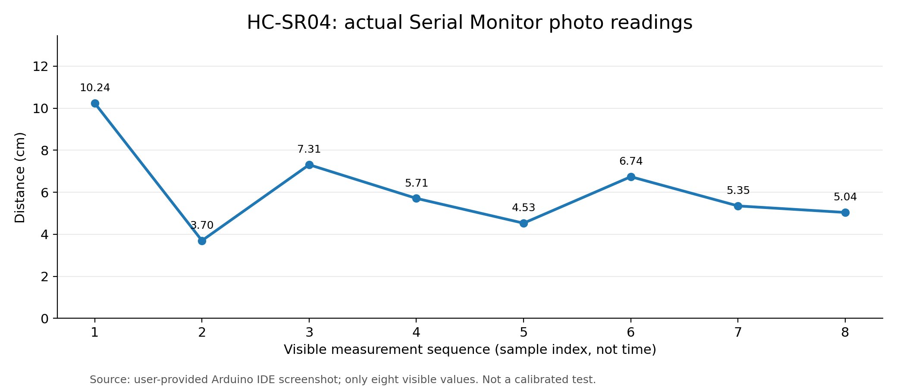

**English** · I plotted eight readings visible in the Serial Monitor photo. Since I didn't record reference distances or timestamps, this shows that the sensor produced readings—not how accurate or fast it was.

**한국어** · 시리얼 모니터에 보이는 거리값 8개를 순서대로 옮겼다. 기준 거리와 측정 시각은 기록하지 않았기 때문에, 이 그래프만으로 정확도나 속도를 평가할 수는 없다. 원본 수치는 [`data/serial_monitor_photo_readings.csv`](data/serial_monitor_photo_readings.csv).

### B. Why distance and speed both matter / 거리와 속도를 함께 고려하는 이유

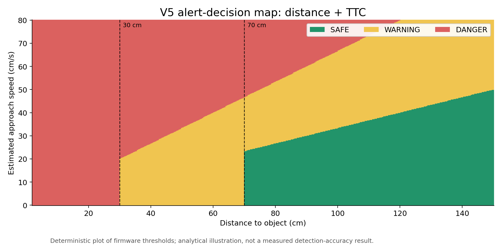

**English** · The colors show which alert the V5 code would select for each distance–speed combination. They describe the decision rule, **not measured detection accuracy**.

**한국어** · 거리와 접근 속도의 조합에 따라 어떤 경고가 켜지는지 그렸다. 실제 위험 탐지 정확도를 실험한 그래프가 아니라, **작성한 코드의 경고 기준**을 시각화한 것이다.

### C. Interpreting TTC / 예상 접촉 시간의 물리적 의미

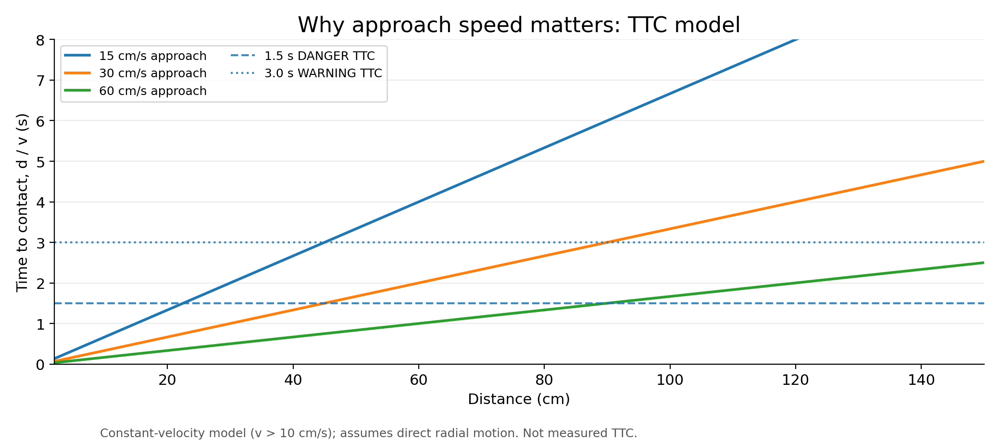

**English** · With a constant approach speed, TTC is simply distance divided by speed. The curves show why an object moving faster can need attention sooner, even at the same distance.

**한국어** · 같은 거리에 있더라도 빠르게 다가오는 물체는 TTC가 더 짧다. 일정한 속도로 정면에 접근한다는 가정 아래 그 관계를 나타냈다.

**Recreate all three figures / 그래프 전체 재생성:**

```powershell
py -m pip install -r analysis/requirements.txt
py analysis/generate_figures.py
```

## Development screenshots / 개발 과정 기록

| **Arduino IDE firmware excerpt / 실제 아두이노 IDE 코드 촬영본** | **Python graphical interface / 실행된 Python GUI** |
|:---:|:---:|
| 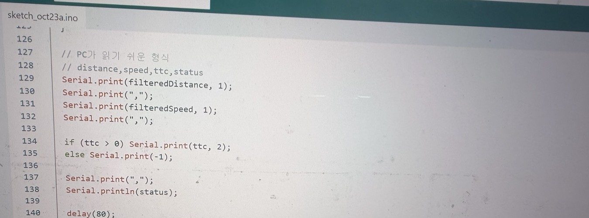 |  |
| *Original photograph from my V5 telemetry coding session during an upload attempt; that attempt showed a COM5 error.* / *V5 출력 코드 업로드 시도 중 촬영한 원본 사진. 당시에는 COM5 오류 발생.* | *Actually captured Python program running in clearly labeled simulation mode, not live sensor telemetry.* / *프로그램 실제 실행 캡처이며 데모 가상값으로 표시. 실측 화면 아님.* |

> **No AI-rendered images are used. / AI 생성 그림 미사용.** Build photographs were taken during the assembly and debugging process; figures were produced from Matplotlib; wiring diagrams are manually constructed vector/CAD schematics; GUI capture comes from an executed Tkinter program. / 사진은 제작 과정에서 직접 촬영한 기록이며, 그래프는 Matplotlib, 배선도는 직접 제작한 벡터 CAD, UI 캡처는 Python 실행 화면을 사용했습니다.

**Detailed technical design / 기술 상세:** [Korean technical note / 국문 기술 설명](docs/ENGINEERING_NOTE_KO.md) · [English engineering note](docs/ENGINEERING_NOTE_EN.md)

## How it works / 작동 원리

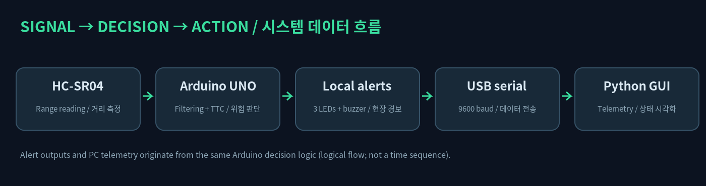

| Module / 기능 | English | 한국어 |
|---|---|---|
| Sensor | HC-SR04 provides echo pulse width, converted to round-trip range | 반사파 왕복 시간으로 거리 계산 |
| Filtering | Exponential smoothing (distance: α = 0.4; speed: α = 0.5) | 거리와 속도의 지수평활 처리 |
| Velocity | Positive value indicates approaching; negative means retreating | 양수: 접근, 음수: 멀어짐 |
| TTC | `distance / approach_speed` only when approach speed exceeds 10 cm/s | 접근 속도가 10 cm/s 초과일 때 TTC 추정 |
| Decision | SAFE / WARNING / DANGER from distance or TTC | 거리 또는 TTC 조건에 따른 3단계 판정 |
| Actuation | D4–D6 LEDs, D7 buzzer; serial output to PC | LED·부저 경고 및 USB 시리얼 출력 |

### Core equations / 핵심 공식

```text
Distance [cm]     = echo_pulse_width [microseconds] × 0.0343 / 2
Smoothed distance = 0.4 × raw_distance + 0.6 × previous_smoothed_distance
Approach speed    = (previous_distance − current_distance) / elapsed_seconds
Smoothed speed    = 0.5 × instant_speed + 0.5 × previous_smoothed_speed
TTC [s]           = distance / approach_speed  (only while approaching > 10 cm/s)
```

These are illustrative approximations; distance noise and measurement geometry can make velocity and TTC fluctuate. / 위 값은 근사치이며 초음파의 측정 잡음, 반사 각도 등에 의해 속도와 TTC가 크게 변할 수 있습니다.

### Alert matrix / 경보 기준표

| Status | Distance / TTC condition | LED | Buzzer | 한국어 |
|---|---|---|---|---|
| SAFE | `d > 70 cm` **and** no TTC warning | Green | Silent | 안전: 초록 / 무음 |
| WARNING | `d ≤ 70 cm` or `0 < TTC ≤ 3.0 s` (excluding DANGER) | Yellow | Slow pulses | 주의: 노랑 / 느린 경고음 |
| DANGER | `d ≤ 30 cm` or `0 < TTC ≤ 1.5 s` | Red | Fast pulses | 위험: 빨강 / 빠른 경고음 |
| NO_SIGNAL | Invalid ultrasonic measurement | LEDs off | Silent | 무효 신호: 표시·경보 꺼짐 |

## Wiring / 배선


| Component / 부품 | Arduino UNO | Connection / 연결 |
|---|---|---|
| HC-SR04 | 5V, GND, D2, D3 | `VCC→5V`, `GND→GND`, `TRIG→D2`, `ECHO→D3` |
| Red LED / 빨간 LED | D4 | `D4→series resistor→LED (+)`, `LED (−)→GND` |
| Yellow LED / 노란 LED | D5 | `D5→series resistor→LED (+)`, `LED (−)→GND` |
| Green LED / 초록 LED | D6 | `D6→series resistor→LED (+)`, `LED (−)→GND` |
| 2-pin buzzer / 2핀 부저 | D7 | `D7→buzzer (+)`, `buzzer (−)→GND` |

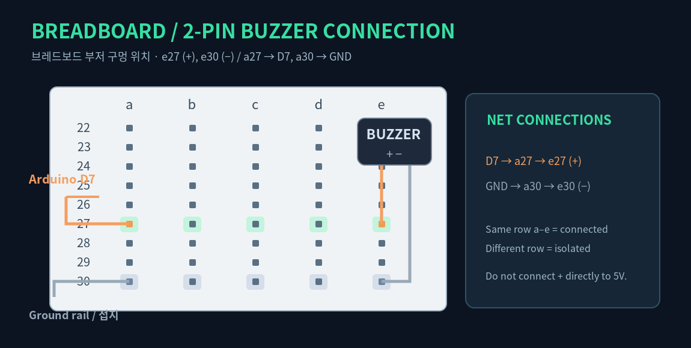

**Breadboard detail / 브레드보드 실제 예시:** buzzer positive at `e27`, negative at `e30`. Connect `a27→D7` and `a30→GND rail`. On a standard breadboard, `a27~e27` are internally connected and separated from `a30~e30`. / 부저 `+ = e27`, `− = e30`; `a27`은 D7, `a30`은 GND 레일에 연결합니다. `a~e` 동일 번호 줄끼리만 연결됩니다.

**Safety / 안전:** Disconnect USB before rewiring. Each LED requires its **own series current-limiting resistor** (typically 220–1,000 Ω depending on brightness). Only drive a confirmed low-current piezo buzzer directly from D7; higher-current units need a transistor driver. / 배선 변경 전 USB를 분리하고, LED마다 전류 제한 저항을 하나씩 사용하세요. 고전류 부저는 D7에 직접 연결하지 마세요.

> The CAD file is a **logical electrical schematic**, not a dimensionally verified reproduction of each jumper wire. The LCD and potentiometer seen in the parts inventory are not implemented in V5. / 본 CAD는 **전기적 연결 도식**이며 점퍼선의 실제 길이와 물리 배치를 정밀 실측한 도면은 아닙니다. 보유 LCD·가변저항은 V5에 아직 연결되지 않았습니다.

## Quick start / 설치 및 실행

### 1 — Upload Arduino firmware / 아두이노 업로드

Open [`arduino/ThreatTrack_V5/ThreatTrack_V5.ino`](arduino/ThreatTrack_V5/ThreatTrack_V5.ino) in Arduino IDE, select **Arduino Uno** and the correct COM port, then press **Upload**. / Arduino IDE에서 `.ino`를 열고 `Arduino Uno` 및 정확한 COM 포트를 선택해 업로드합니다.

### 2 — Install Python dependency / Python 라이브러리 설치

From the project root / 프로젝트 최상위 폴더에서:

```powershell
py -m pip install -r python/requirements.txt
```

### 3 — Identify port, launch / 포트 확인 및 실행

```powershell
py python/threat_track_dashboard.py --list-ports
py python/threat_track_dashboard.py --port COM5
```

**Close the Arduino Serial Monitor before opening the dashboard**. Only one application can control COM5 at a time. / **Python을 실행하기 전 Arduino 시리얼 모니터를 닫아야 합니다.** COM 포트는 다른 프로그램과 동시에 점유할 수 없습니다.

### Offline design preview / 센서 없이 UI 미리보기

```powershell
py python/threat_track_dashboard.py --demo
```

The demo mode displays **simulated values** and visibly labels them. / 데모 모드는 **가상 측정값**을 사용하며 화면에 시뮬레이션임을 표시합니다.

### Run tests / 코드 테스트

```powershell
py -m unittest discover -s tests -v
```

## Project status / 프로젝트 진행 상태

| Milestone | Status | Evidence / 설명 |
|---|---|---|
| Arduino UNO Blink | ✅ Confirmed / 확인 | Board LED flash validated during build |
| HC-SR04 range readings | ✅ Confirmed / 확인 | Actual serial-monitor photograph above |
| Three-state LED warnings | ✅ 제작 중 정상 동작 확인 | Red, yellow, green LEDs working |
| Buzzer audio alert | ✅ 제작 중 정상 동작 확인 | Audible buzzer working |
| Python GUI startup | ✅ 실제 프로그램 창 실행 확인 | Desktop interface opens |
| V5 live Arduino→Python telemetry | ⚠️ Pending re-verification / 재확인 필요 | An observed COM5 port collision blocked a firmware upload; live refresh not yet re-confirmed |
| LCD and potentiometer features | Not implemented / 미구현 | Future extension only |

## Troubleshooting / 문제 해결

**Problem / 문제: UI opens but numbers never change.** The Arduino firmware may be an older V4 format, or COM5 may still be held by Python/Arduino IDE. / 화면은 뜨지만 값이 바뀌지 않는 경우 구형 시리얼 형식이나 COM 포트 점유가 원인일 수 있습니다.

1. Close the Python window and its CMD process / Python 화면과 CMD 종료
2. Close Arduino Serial Monitor / 시리얼 모니터 닫기
3. Upload the V5 `.ino` again, and confirm **Done uploading** / V5 코드 다시 업로드 후 완료 확인
4. Temporarily open Serial Monitor at **9600 baud**; verify `23.4,42.8,0.55,DANGER`-style lines / 쉼표 4개 항목 형식 출력 확인
5. Close Serial Monitor, then run the dashboard / 시리얼 모니터 닫고 Python 실행

For an actual example of a COM5 conflict / 실제 포트 충돌 화면:

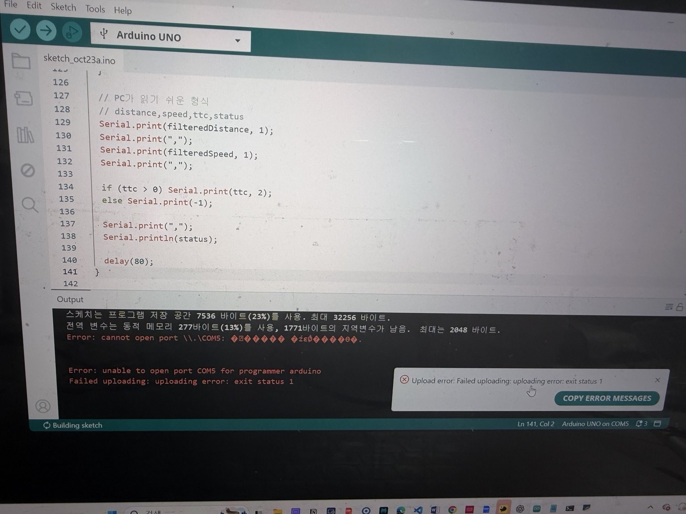

**Evaluation protocol / 향후 실험 계획:** [Validation methodology (KR/EN)](docs/VALIDATION_PLAN.md)

## What I'd test next / 다음에 검증해 보고 싶은 것

아두이노 코드, 시리얼 데이터 파서, 그래프 생성 코드를 저장소에 함께 넣었다. Python 데모 값은 실제 측정값과 구분하고, Matplotlib 그래프는 CSV와 코드의 계산식으로 다시 생성할 수 있도록 구성했다.

**English** · The repository includes the Arduino firmware, serial parser, and plotting code. Simulated UI data is labeled separately from physical measurements, and the figures can be regenerated from the stored inputs.

다음에는 기준 거리를 고정하고 여러 번 측정해 오차를 비교해 보고 싶다. 움직이는 물체의 기준 궤적도 기록하면 접근 속도와 TTC의 오차, 경고가 바뀌는 데 걸리는 시간까지 살펴볼 수 있다. **아직 진행하지 않은 실험이다.**

**English** · My next step is to collect repeated measurements at known distances, compare estimated speed with a reference trajectory, and measure how quickly the alert responds. **Those tests haven't been carried out yet.**

The GUI is an HMI prototype that favors separation of sensing, control, and display. The sweeping radar graphic is stylistic only and does not convey bearing information. / GUI는 센싱·제어·표시 계층을 분리한 HMI 실험이며, 레이더 회전 효과는 시각적 표현일 뿐 방위각을 측정하지 않습니다.

## Repository layout / 저장소 구조

```text
.
├── README.md
├── .github/workflows/quality.yml
├── arduino/ThreatTrack_V5/ThreatTrack_V5.ino
├── python/threat_track_dashboard.py
├── python/telemetry.py
├── python/requirements.txt
├── analysis/{generate_figures.py,requirements.txt}
├── docs/{ENGINEERING_NOTE_KO.md,ENGINEERING_NOTE_EN.md,VALIDATION_PLAN.md}
├── data/serial_monitor_photo_readings.csv
├── assets/charts/{serial-readings-photo.png,alert-decision-map.png,ttc-model.png}
├── assets/diagrams/{wiring-cad.svg,wiring-cad.png,system-flow.svg,system-flow.png,buzzer-breadboard.svg,buzzer-breadboard.png}
├── assets/screenshots/{hardware-prototype.jpg,ultrasonic-wiring.jpg,serial-monitor.jpg,
│                     arduino-ide-code-photo.jpg,dashboard-demo-screenshot.png,com-port-error.jpg}
├── docs/cad/threat-track-schematic.dxf
└── tests/test_telemetry.py
```

## Limits / 구현 범위와 한계

**English** · The system measures forward distance, not target identity or direction. Moving objects and reflective surfaces can make the readings fluctuate. The radar sweep is visual styling only, and I haven't measured accuracy, false-alarm rate, or real-world reliability.

**한국어** · 지금은 센서 정면의 거리만 측정할 수 있고 물체의 종류나 방향은 구분하지 못한다. 반사면과 움직임에 따라 측정값이 흔들릴 수 있으며, TTC에도 일정한 접근 속도라는 가정이 들어간다. 아직 정확도나 오경보율을 검증한 단계가 아니므로 실제 안전장치나 군용 탐지기로 사용할 수는 없다.

## Author / 제작

**Doyun Shin · 신도윤**  
Gachon University · Industrial Engineering / 가천대학교 산업공학과  
Personal embedded-systems and human–machine interface portfolio / 개인 임베디드·인간–기계 인터페이스 프로젝트

**Asset provenance / 자료 출처:** [Full source and evidence disclosure](assets/ASSET_PROVENANCE.md) · [Wiring CAD notes](docs/cad/README.md)

**Documentation note / 문서 고지:** Hardware and serial-monitor photographs document my actual build and debugging sessions. The CAD files explain the circuit connections, and the Python GUI screenshot was taken in `--demo` mode, so its numbers are simulated. / 사진은 직접 조립하고 개발하면서 촬영한 기록이며, CAD는 배선 연결을 정리한 도면이고, Python GUI 사진은 데모 모드에서 실행한 화면이라 숫자는 가상 데이터다.